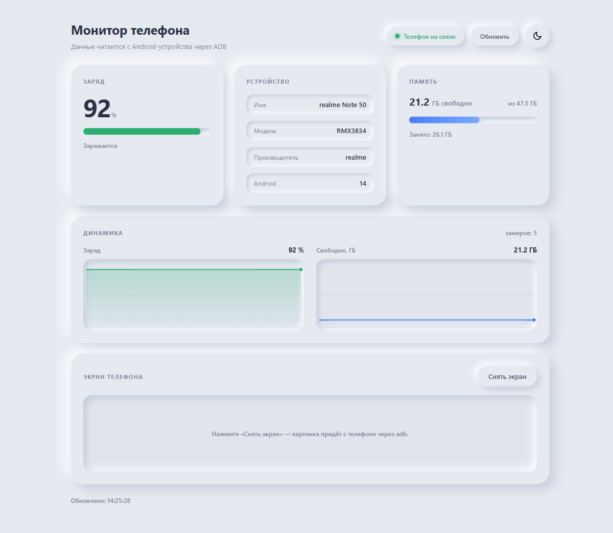
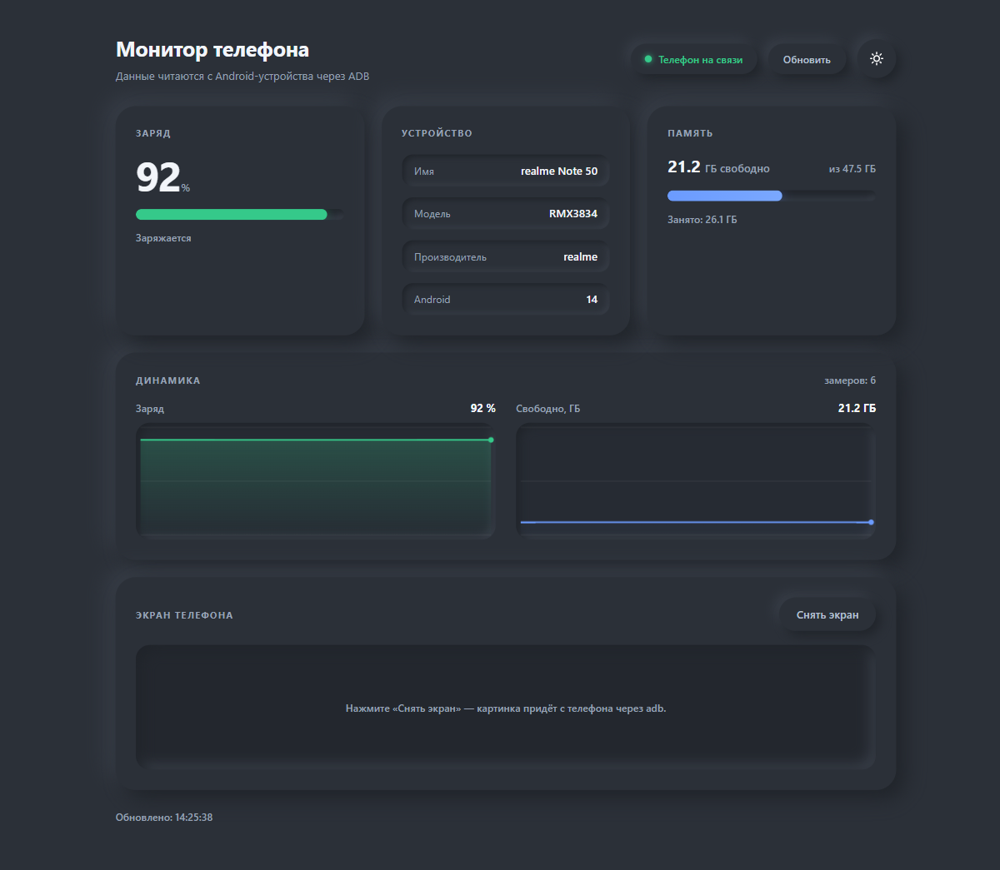

# Device Monitor

домашний пет-проект: читаю с андроида по usb заряд, модель и свободное место и рисую
на страничке. данные тянет `adb` из platform-tools, отдаются по json api, фронт — чистый
html/css/js без фреймворков.

всё локально, без интернета и облака: сервер, телефон и браузер на одной машине.

[](https://github.com/dc1d3/device-monitor/actions/workflows/build.yml)


## скриншоты

| светлая тема | тёмная тема |
|---|---|
|  |  |

## что умеет

- показывает заряд, статус зарядки, имя, модель, производителя, версию android и свободное место
- рисует графики заряда и памяти за последние ~10 минут (история просто в памяти, без базы данных)
- снимает экран телефона прямо в браузере
- светлая и тёмная неоморфная тема, выбор запоминается
- кэш на 5 секунд, чтобы несколько вкладок не дёргали `adb` без остановки
- есть демо-режим без телефона (`app.device.mock=true`)
- у ошибок api один общий формат, плюс есть swagger ui, где всё можно потыкать руками
- тесты: разбор вывода `adb`, кэш и история, http-контракт

## как это работает

```
Браузер  ──GET /api/device──▶  Controller  ──▶  Service (кэш 5 с)
                                                  │
                                                  ▼
                                            DeviceDataSource
                                             ├── AdbDeviceDataSource   (реальный телефон)
                                             └── MockDeviceDataSource  (демо без телефона)
                                                  │
                                                  ▼
                                       adb shell dumpsys battery / df / getprop
```

смысл такой: контроллер и сервис про adb вообще не знают. источник данных — интерфейс,
поэтому приложение спокойно запускается и без телефона, а заменить adb на что-то другое
можно одним классом. разбор текстового вывода `adb` вынесен в `AdbOutputParser` и покрыт
юнит-тестами — для них не нужны ни телефон, ни platform-tools.

## стек

| слой | чем |
|---|---|
| бэкенд | java 21, spring boot 3.5, maven |
| api | rest + json (jackson), springdoc-openapi |
| фронт | html + css + javascript, без фреймворков |
| оформление | неоморфизм, светлая и тёмная темы |
| тесты | junit 5, assertj, mockmvc |

## структура

```
src/main/java/com/example/devicemonitor/
├── DeviceMonitorApplication.java
├── api/           DeviceController, DTO, ApiError, ApiExceptionHandler
├── service/       DeviceService (кэш и история)
├── datasource/    DeviceDataSource, AdbDeviceDataSource, MockDeviceDataSource,
│                  AdbOutputParser
├── model/         DeviceSnapshot, HistoryPoint
└── config/        DeviceProperties, DataSourceConfig, OpenApiConfig

src/main/resources/
├── application.yml
└── static/        index.html, style.css, app.js

src/test/java/...  AdbOutputParserTest, DeviceServiceTest, DeviceControllerTest
docs/              скриншоты для README
```

## как запустить

```bash
git clone https://github.com/dc1d3/device-monitor.git
cd device-monitor
```

нужны **jdk 21+** и **android platform-tools** (достаточно только `adb`, android studio
не нужен). maven ставить не надо: в проекте есть maven wrapper.

### windows

```bat
run.cmd
```

скрипт сам находит jdk, `adb` и maven (`mvnw.cmd`), потом поднимает сервер на
<http://localhost:8080>. или руками:

```bat
mvnw.cmd spring-boot:run
```

### macos / linux

```bash
chmod +x mvnw
./mvnw spring-boot:run
```

если `adb` не в `path`, путь указывается так:

```bash
ADB_PATH=/path/to/adb ./mvnw spring-boot:run
```

### демо-режим (телефон не нужен)

```bat
run-mock.cmd
```

```bash
./mvnw spring-boot:run -Dspring-boot.run.arguments=--app.device.mock=true
```

### документация api

после запуска смотри <http://localhost:8080/swagger-ui.html>
(json-спецификация — `/v3/api-docs`).

## как подключить телефон

1. **настройки → о телефоне → 7 раз тапнуть по «номер сборки»** — включится режим разработчика
2. **настройки → система → для разработчиков → отладка по usb** — включить
3. подключить кабель, на телефоне подтвердить окно **«разрешить отладку по usb»**
4. проверить: `adb devices` — устройство должно быть со статусом `device`

**если adb «залип»** (`protocol fault (couldn't read status): connection reset`),
запусти `adb-restart.cmd` — он перезапустит демон adb и покажет список устройств.

## api

| метод | путь | что делает |
|---|---|---|
| `GET` | `/api/device` | текущее состояние (из кэша) |
| `POST` | `/api/device/refresh` | перечитать данные, минуя кэш |
| `GET` | `/api/history` | до 120 последних замеров |
| `GET` | `/api/screen` | png-снимок экрана |

### `GET /api/device`

```json
{
  "connected": true,
  "battery": 92,
  "charging": true,
  "name": "realme Note 50",
  "manufacturer": "realme",
  "model": "RMX3834",
  "androidVersion": "14",
  "storage": { "totalGb": 47.5, "usedGb": 26.1, "freeGb": 21.2 },
  "readAt": "2026-11-18T11:24:58.816Z",
  "error": null
}
```

телефон не подключён — ответ всё равно `200`, просто с `connected: false` и текстом ошибки:

```json
{
  "connected": false,
  "battery": null,
  "error": "Телефон не найден. Подключите кабель и разрешите отладку по USB.",
  "readAt": "2026-11-18T11:24:58.816Z"
}
```

### `GET /api/history`

история живёт в памяти (последние 120 точек, при опросе раз в 5 с это примерно 10 минут):

```json
{ "points": [ { "at": "2026-11-18T11:02:31Z", "battery": 72, "freeGb": 40.8 } ] }
```

### `GET /api/screen`

png-снимок экрана (`adb exec-out screencap -p`), `Content-Type: image/png`.
если телефон недоступен — `503` и json с ошибкой. служебный вывод adb в картинку не попадает.

### ошибки

все ошибки приходят в одном формате, http-код при этом остаётся правильным
(404, 405, 415, 500, 503):

```json
{
  "timestamp": "2026-11-18T11:30:00Z",
  "status": 405,
  "error": "Method Not Allowed",
  "message": "Метод не поддерживается для этого адреса",
  "path": "/api/device"
}
```

## настройки (`application.yml`)

| ключ | по умолчанию | смысл |
|---|---|---|
| `app.device.mock` | `false` | `true` — фейковые данные, телефон не нужен |
| `app.device.adb-path` | `adb` | путь к `adb.exe`; можно задать через `ADB_PATH` |
| `app.device.timeout-ms` | `4000` | таймаут одной команды adb |
| `app.device.cache-ms` | `5000` | сколько отдавать закэшированный снимок |

пример: `mvnw.cmd spring-boot:run -Dspring-boot.run.arguments=--server.port=8081`

## тесты

```bash
./mvnw test
```

20 тестов, телефон и adb не нужны:

- `AdbOutputParserTest` — разбирает `adb devices`, `dumpsys battery`, `df /data`
  (там есть и реальный вывод realme с нестандартной точкой монтирования)
- `DeviceServiceTest` — кэш, принудительное обновление, лимит истории, офлайн-снимки
- `DeviceControllerTest` — json-контракт, png, 405/404 в общем формате, openapi

## ci

github actions (`.github/workflows/build.yml`) на каждый push и pull request:
jdk 21 + кэш maven + `./mvnw -B verify`.

## что читается с телефона

| данные | команда |
|---|---|
| заряд, статус | `adb shell dumpsys battery` |
| имя | `adb shell settings get global device_name` |
| модель, производитель, версия android | `adb shell getprop ro.product.*` |
| свободное место | `adb shell df /data` |
| скриншот | `adb exec-out screencap -p` |

## частые проблемы

| симптом | что делать |
|---|---|
| `protocol fault (couldn't read status)` | `adb kill-server`, пауза 2 с, `adb start-server` (или `adb-restart.cmd`) |
| `connected: false` | проверить `adb devices`, кабель и подтверждение отладки на телефоне |
| порт 8080 занят | `--server.port=8081` в аргументах запуска |
| `JAVA_HOME is not set` | поставить jdk 21 или указать `JAVA_HOME` |
| чёрный скриншот | экран телефона выключен или заблокирован — разблокировать и повторить |

## лицензия

[mit](LICENSE) © 2026 dc1d3
